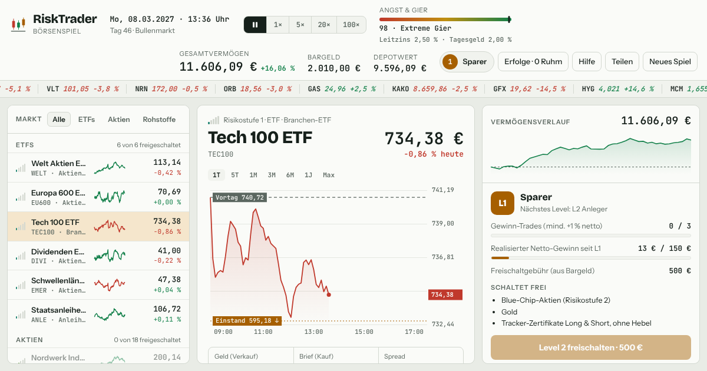

# RiskTrader

Ein Börsenspiel im Browser: Starte mit 10.000 € Spielgeld, handle ETFs, Aktien, Rohstoffe, Zertifikate und Optionsscheine und schalte Schritt für Schritt riskantere Produkte frei.

**▶ Jetzt spielen: https://tumbeldor.github.io/RiskTrader/**

Alles steckt in einer einzigen Datei: [`index.html`](index.html). Kein Server, keine Installation, läuft am Rechner und am Handy.

## Spielen

- **Im Browser:** Den Link oben öffnen und an Freunde schicken.
- **Offline:** `index.html` herunterladen und doppelt anklicken.
- **Fairer Vergleich:** Unter „Neues Spiel“ einen Seed eingeben. Gleicher Seed bedeutet gleicher Kursverlauf und gleiche Nachrichten. Im Modus „Challenge“ wird nach 252 Handelstagen abgerechnet, „Teilen“ kopiert das Ergebnis.

Der Spielstand wird im Browser gespeichert (localStorage).

## Spielzeit

Die Börse hat von 9:00 bis 17:30 Uhr geöffnet, alle 6 Minuten gibt es neue Kurse, über Nacht kann der Kurs springen.
Bei **1×** dauert eine Börsenstunde 10 Sekunden, ein Handelstag also knapp 1,5 Minuten. Mit **5×**, **20×** und **100×** spult man vor (100×: ein Handelstag in knapp einer Sekunde). Die Leertaste pausiert.
Das Grundtempo steht in `index.html` in der Konstante `SEC_PER_HOUR`.

## Langzeit-Inhalte

- **Börsenkalender:** Quartalszahlen mit Analystenstimmung, Zinsentscheide mit Markterwartung, Dividenden-Termine und Zulassungsentscheide stehen 20 Tage im Voraus fest.
- **Geschichten über mehrere Tage:** Übernahmeschlachten (Gerücht, Angebot, Bieterkampf oder Kartellamt), Social-Media-Hypes, Bilanzskandale und Hurrikane.
- **Neuemissionen:** Sechs Börsengänge im Laufe des Spiels. Zeichnen ist gebührenfrei, bei hoher Nachfrage gibt es nur eine Teilzuteilung.
- **Leitzins & Tagesgeld:** Der Leitzins ändert sich bei Zinsentscheiden. Er bestimmt die Zinsen auf dein Bargeld, die Knock-Out-Finanzierung und die Optionspreise.
- **Dividenden:** Vierteljährlich, steuerpflichtig, zählen fürs Level.
- **Rivalen:** Vera Vorsicht, Bernd Bausparer, Hedgefonds-Hanna, Dart-Affe Kurt und Zocker-Zoe handeln im selben Markt. Rangliste und Jahresbilanz zeigen, wer vorn liegt.
- **Angst-und-Gier-Index** für die Stimmung am Gesamtmarkt.
- **Erfolge, Ruhm & Ruhestand:** 29 Erfolge. Im freien Spiel kann man sich ab dem 2,5-Fachen des Startkapitals zur Ruhe setzen. Mit Ruhm kauft man dauerhafte Boni (mehr Startkapital, günstigere Gebühren, engere Spreads, höherer Freibetrag, günstigere Level, bessere Tipps). In der Challenge gelten keine Boni.
- **Automatische Pause** bei wichtigen Ereignissen rund um die eigenen Positionen.

## Regeln in Kürze

**Risikostufen.** ETFs (Stufe 1) schwanken am wenigsten und steigen oder fallen langsam. Blue Chips und Gold (2), Nebenwerte und Rohstoffe (3), Wachstumswerte (4) und Pennystocks (5) schwanken jeweils deutlich stärker.

**Was Geld kostet**, damit man nicht einfach immer reicher wird:

| Kostenart | Höhe |
| --- | --- |
| Spread | 0,06 % (Anleihen-ETF) bis 1,8 % (Pennystock), steigt nach Nachrichten |
| Ordergebühr | 4,90 € pro Kauf und Verkauf |
| Steuer | 26,375 % auf Gewinne über 1.000 € Freibetrag pro Jahr, mit Verlusttopf |
| Zertifikate | Verwaltungsgebühr, Finanzierungskosten (Knock-Out), Zeitwertverlust (Optionsscheine), Volatilitätsverlust (Faktor) |
| Freischaltung | Jedes neue Level kostet eine Gebühr aus dem eigenen Bargeld |

**Level.** Ein Gewinn-Trade ist ein Verkauf mit mindestens +1 % Netto-Rendite und 100 € Einsatz.

| Level | Bedingung seit letztem Level | Gebühr | Schaltet frei |
| --- | --- | --- | --- |
| 1 Sparer | – | – | ETFs |
| 2 Anleger | 3 Gewinn-Trades, +150 € | 500 € | Blue Chips, Gold, Tracker-Zertifikate (ohne Hebel) |
| 3 Trader | 4 Gewinn-Trades, +600 € | 1.500 € | Nebenwerte, Silber/Öl/Kupfer/Weizen, Discount-Zertifikate (ohne Hebel) |
| 4 Spekulant | 5 Gewinn-Trades, +1.500 € | 3.000 € | Wachstumsaktien, Erdgas/Kakao, Faktor 2x/3x |
| 5 Zocker | 6 Gewinn-Trades, +3.000 € | 6.000 € | Pennystocks, Knock-Outs bis 10x, Optionsscheine |
| 6 Börsenhai | 8 Gewinn-Trades, +8.000 € | 15.000 € | Faktor 5x/10x, Knock-Outs 15x/25x |

Alle Unternehmen sind erfunden, alle Kurse simuliert. Kein echtes Geld, keine Anlageberatung.

## Veröffentlichung über GitHub Pages

Die Seite wird direkt aus diesem Repository ausgeliefert. Einmalig einrichten:
**Settings → Pages → Build and deployment → Source: „Deploy from a branch“**, Branch auswählen, Ordner `/ (root)`, **Save**.
Nach ungefähr einer Minute ist das Spiel unter https://tumbeldor.github.io/RiskTrader/ erreichbar. Jeder Push auf den Branch aktualisiert es automatisch.
